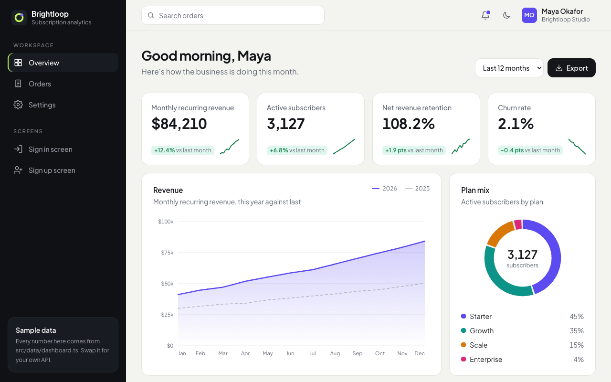

# Brightloop: React dashboard template

A free React admin dashboard template with KPI cards, charts, a full data table, settings and sign-in screens. Static, fast and easy to make your own.



[](https://console.cloudzyro.com/new?repo=https://github.com/Cloudzyro/template-dashboard)

## What's included

- Sidebar and top bar layout, with a slide-out menu on phones and tablets
- Overview page: four KPI cards with sparklines, a revenue chart with hover details, a plan mix donut, weekly sign-ups, recent activity and latest orders
- Charts drawn with plain SVG (no chart library), which follow dark mode and include hidden data tables for screen readers
- Orders table with sorting, text filter, status filter, pagination, rows per page, row selection and CSV export
- Order detail page with line items, totals, a timeline and customer details
- Settings page with profile, workspace and notification forms
- Sign-in and sign-up screens (UI only, clearly marked: connect your own auth)
- Dark mode that follows the system setting and remembers the visitor's choice
- Hash routing, so every page and deep link works on any static host
- Accessible: semantic tables with sort state, labeled controls, visible focus, skip link, reduced motion respected

## Run it locally

```bash
pnpm install
pnpm dev        # http://localhost:5173
pnpm build      # static site in dist/
pnpm preview    # serve the built site
```

## Make it yours

- **Text, menu, KPIs, chart data and orders:** everything lives in `src/data/dashboard.ts`. Replace the sample arrays with calls to your own API when you're ready.
- **Colors:** edit the CSS variables in `src/index.css` (`:root` for light, `.dark` for dark). Chart colors are `--chart-1` to `--chart-4`.
- **Fonts:** Plus Jakarta Sans and JetBrains Mono are self-hosted through Fontsource and imported at the top of `src/index.css`.
- **Pages:** add a page in `src/pages/`, a route in `src/main.tsx` and a menu item in `src/data/dashboard.ts`.
- **Sign-in and sign-up:** the screens in `src/pages/Auth.tsx` don't create accounts or check passwords. Connect your auth provider (for example Supabase Auth, Clerk or your own API) in the `onSubmit` handler, and protect the dashboard routes once you have a session.
- **Social card:** replace `public/og-image.png` (1200x630).

Optional build-time variables:

| Variable | What it does |
| --- | --- |
| `VITE_SITE_URL` | Your public address, used for the social card and sitemap |
| `VITE_ALLOW_INDEXING` | Set to `true` to let search engines index the site. Off by default, since dashboards are usually private |

## Routing on static hosts

The app uses React Router's hash router, so addresses look like `/#/orders/BL-2300`. The part after `#` never reaches the server, which only ever sends `index.html`. Deep links and page refreshes work on nginx, Cloudzyro, GitHub Pages, S3 or any static host with no rewrite rules.

The build also writes `dist/404.html` (a copy of `index.html`), so a mistyped path still opens the app.

If you'd rather have clean addresses without `#`, switch to `createBrowserRouter` in `src/main.tsx` and add an SPA fallback on your server. For nginx:

```nginx
location / {
  try_files $uri $uri/ /index.html;
}
```

## Deploy

Click the **Deploy to Cloudzyro** button above, or push your own copy to GitHub and connect it in the Cloudzyro console. The build command is `pnpm build` and the output folder is `dist`. No server is needed.

## Stack

- [React](https://react.dev) 19 and [React Router](https://reactrouter.com) 8
- [Vite](https://vite.dev) 8
- [Tailwind CSS](https://tailwindcss.com) 4
- TypeScript

## License

MIT, see [LICENSE](./LICENSE).
